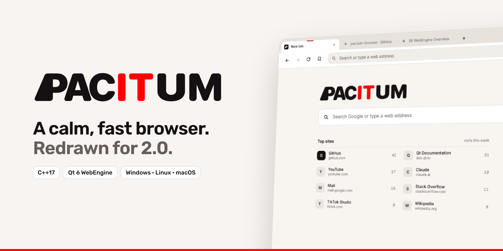
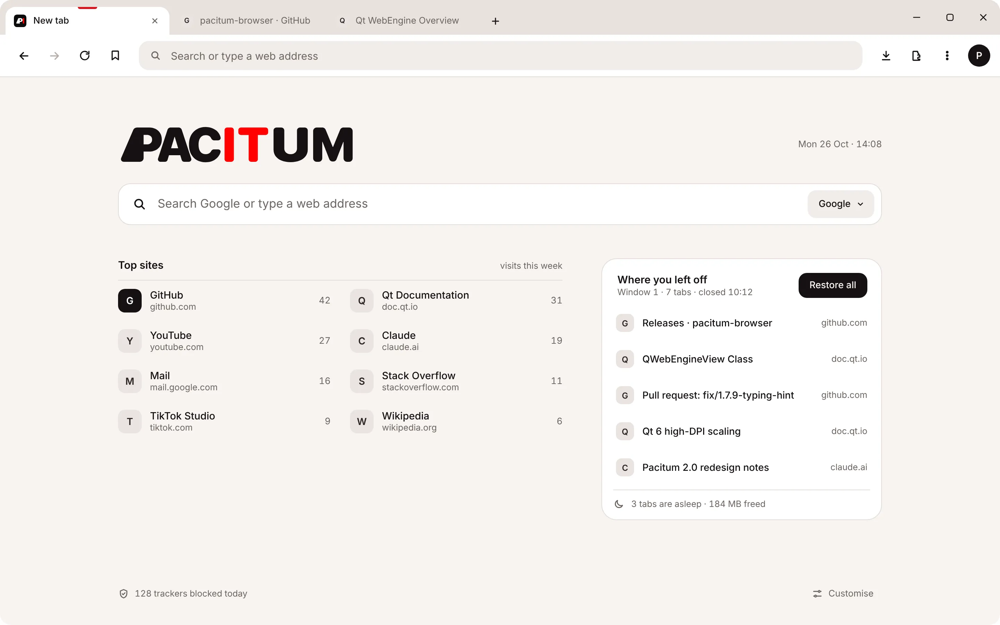
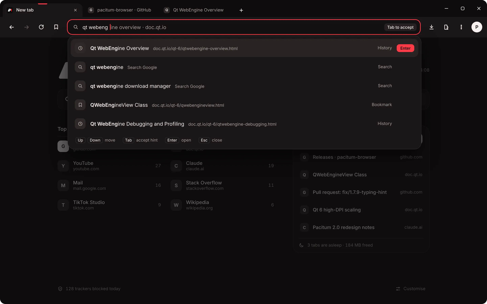

<p align="center">
  <picture>
    <source media="(prefers-color-scheme: dark)" srcset="docs/readme/banner-dark.png">
    
  </picture>
</p>

<p align="center">
  <a href="https://github.com/namo2024mntik-ops/pacitum-browser/releases/latest"><b>Download</b></a> ·
  <a href="#whats-new-in-200">What's new</a> ·
  <a href="#build-from-source">Build from source</a> ·
  <a href="BUILD.md">BUILD.md</a>
</p>

# Pacitum Browser 2.0

Pacitum is a calm, fast web browser written in C++17 on **Qt 6 WebEngine**. It runs the same Chromium engine as Chrome and Edge, and keeps its own interface out of the way so the page gets the space. It runs on Windows, Linux and macOS.

**2.0.0 redraws the whole browser**: a new identity, and a new look for every screen from the tab strip to the smallest dialog.

## Download

| Windows | Linux | macOS (Apple silicon) |
|---|---|---|
| `PacitumBrowser-Setup-2.0.0.exe` | `PacitumBrowser-2.0.0-linux-x86_64.AppImage` | `PacitumBrowser-2.0.0-macOS-arm64.dmg` |

Get the file for your system from the [latest release](https://github.com/namo2024mntik-ops/pacitum-browser/releases/latest). Each file has a `.sha256` checksum next to it. Pacitum updates itself after that.

## What's new in 2.0.0

<p align="center">
  
  
</p>

- **New identity.** The wordmark is PACI and TUM on one line, with a new app icon and one red.
- **Warm paper and ink.** Light is warm neutrals with ink text; dark swaps every colour. One red marks only what is selected.
- **Tab strip.** The active tab is white and merges into the toolbar, marked by a short red bar on its top edge. The other tabs sit flat on the strip.
- **Address bar.** One field for search and addresses, with suggestions from your search engine and your history, and the keys to move through them.
- **New tab page.** Top sites with visit counts, "Where you left off" to restore your last window, and how many tabs are asleep.
- **More menu (⋮).** History, downloads, zoom and print in one menu.
- **Extensions, profiles and site permissions.** A new extension manager, a profile picker, and permission prompts that say what a site wants.
- **Settings and themes.** Every setting on one page with a sidebar, and themes that recolour the whole browser.

## Features

- **Chrome extensions.** Click **Add to Pacitum** on a Chrome Web Store page, or add a `.crx`, `.zip` or unpacked folder. Pacitum lists what an extension may do before you add it.
- **Search suggestions** from Google, Bing, DuckDuckGo, Brave or Yahoo, plus up to four pages from your history.
- **Split view and tools.** Two pages side by side, screenshot, picture-in-picture, a notes panel and a QR code for the page.
- **Reader mode and Translate.**
- **Bookmark folders** on the bookmarks bar, with Open all, drag and drop, and sync.
- **Google sync.** Bookmarks, settings, notes and recent history sync through a private area of your Google Drive. See [`SYNC.md`](SYNC.md).
- **Safer downloads and updates.** Downloads are marked as from the internet on Windows so SmartScreen checks them. The updater only installs a release with a SHA-256 checksum, over HTTPS from GitHub.
- **Ad and tracker blocking**, private tabs and session restore.

## System requirements

| | Windows | Linux | macOS |
|---|---|---|---|
| **OS** | Windows 10 (1809+) or Windows 11, 64-bit | x86_64 with glibc 2.35+ (Ubuntu 22.04, Debian 12, Fedora 36 or newer) | Apple silicon; may need a newer macOS than 12 |
| **CPU** | x86_64 | x86_64 | Apple silicon (M1 or newer) |

- **Memory:** 4 GB minimum, 8 GB recommended (each site runs in its own Chromium process; Pacitum caps this at 8).
- **Disk:** about 500 MB free, plus space for cache, profile data and extensions.
- **Graphics:** Direct3D 11 (Windows), OpenGL (Linux) or Metal (macOS). With a broken driver, start with `PACITUM_DISABLE_GPU=1` for software rendering.
- **Linux AppImage:** needs FUSE (`libfuse2`), or run it with `--appimage-extract-and-run`.
- **macOS:** the app isn't notarized. The first time, right-click it and choose **Open**.

## Build from source

You need Qt 6.11 or newer with Qt WebEngine, Qt WebChannel and Qt Positioning, CMake 3.16+, Ninja and a C++17 compiler (MSVC 2019+, GCC 11+ or Apple Clang).

```bash
cmake -B build -G Ninja -DCMAKE_BUILD_TYPE=Release -DCMAKE_PREFIX_PATH="<path to Qt>/<version>/<kit>"
cmake --build build
./build/PacitumBrowser        # build\PacitumBrowser.exe on Windows
```

[`BUILD.md`](BUILD.md) has the steps for each system, the Windows installer and the AppImage and dmg builds.

## Source map

Pacitum started as a Python browser and was ported to C++ file by file.


| Python (`safari_browser/*.py`) | C++ (`safari_browser_cpp/include|src/*.cpp`) |
|---|---|
| `main.py` | `src/main.cpp` |
| `browser_window.py` | `BrowserWindow.h/cpp` |
| `browser_tab.py` | `BrowserTab.h/cpp` |
| `tab_widget.py` | `TabWidget.h/cpp` (PacitumTabWidget + PacitumTabBar) |
| `address_bar.py` | `AddressBar.h/cpp` |
| `bookmark_manager.py` | `BookmarkManager.h/cpp` |
| `bookmarks_bar.py` | `BookmarksBar.h/cpp` |
| `history_manager.py` | `HistoryManager.h/cpp` (SQLite via QtSql) |
| `download_manager.py` | `DownloadManager.h/cpp` |
| `find_bar.py` | `FindBar.h/cpp` |
| `ad_blocker.py` | `AdBlocker.h/cpp` (QWebEngineUrlRequestInterceptor) |
| `session_manager.py` | `SessionManager.h/cpp` |
| `zoom_controller.py` | `ZoomController.h/cpp` |
| `settings_dialog.py` | `SettingsPage.h/cpp` (full-page settings tab) |
| — | `WebProfile.h/cpp` (UA, Accept-Language, persistent profile) · `Widgets.h/cpp` (animated buttons, switches, spinner) |
| `theme_manager.py` | `ThemeManager.h/cpp` (Pacitum design tokens → QSS, SVG icon tinting) |
| — | `PacitumScheme.h/cpp` (`pacitum://newtab` internal page) |

## Documentation

- [`BUILD.md`](BUILD.md): building on Windows, Linux and macOS
- [`SYNC.md`](SYNC.md): setting up Google sync
- [`PERMISSIONS.md`](PERMISSIONS.md): site permissions
- [`release-notes/`](release-notes): notes for every release

<details>
<summary><b>Version history (1.1 to 1.9.1)</b></summary>

Version 1.9.1 and 1.8.12 (two editions from the same source):
- **Pacitum 1.9.x** is built with **Qt 6.11** (newer Chromium) and runs **Chrome extensions**: "Add to Pacitum" on a Chrome Web Store page, or add a `.crx` / `.zip` / unpacked folder from the puzzle menu. Pin an extension to the toolbar to open its pop-up; switch it off or remove it from the same menu. Before adding, Pacitum lists what the extension may do.
- **Pacitum 1.8.x** is the **legacy edition** (Qt 6.8 LTS) for computers that can't run the Qt 6.11 build. It gets everything below, but not Chrome extensions, and its updater stays on 1.8.x. **1.8.12 is the last legacy release**: from 1.9.1 on, only the Qt 6.11 edition is built.
- Both: **bookmark folders** (on the bookmarks bar, with a drop-down; right-click to make one or move a bookmark; drag a bookmark onto a folder; pick the folder right after pressing ☆). Folders sync.
- Both: **animations**. Menus, pop-ups and dialogs zoom out of where you opened them, a new window opens with a growing circle, and on macOS and Linux the window shrinks away when closed, drops when minimized and morphs when maximized (Windows animates these itself). The update pop-up zooms in with a soft bounce.
- Both: **security**. Downloads are marked as "from the internet" on Windows so SmartScreen checks them; more file types that run code are held until you confirm; the updater only installs a release with a SHA-256 checksum, downloaded over HTTPS from GitHub.
- Both: **fixes**. The reload button's spin animation never played; restoring a minimized window refreshed the wrong tabs; `localhost:3000` and IP addresses were searched instead of opened; `chrome-extension://` addresses broke; old bookmark chips could flash over new ones; bookmarks are saved atomically.

**1.9.1 fixes**
- Turning a Chrome extension on crashed Pacitum 1.9.0. The main profile is now created with its storage folder (Qt 6.9+), so Qt no longer rebuilds its preferences under the extension engine.
- Extensions from the Chrome Web Store keep their real Chrome ID.

**1.9.0 / 1.8.12 fixes**
- Clicking **Update** on the update card closed Pacitum (1.8.9–1.8.11). The pop-up now opens. On those versions, click **Later** on the card, then the update button in the toolbar, or download Setup from the releases page.
- The profile picture and the ⋮ menu sat on top of the Back button. They are back at the right end of the toolbar.
- The updater picks the installer that has a `.sha256` file, so an extra hand-uploaded file in a release isn't used by mistake.
- If the install helper can't start, Pacitum opens the normal Setup window instead of closing with nothing installed.
- Before installing, the helper waits for Pacitum's background processes to close, so Setup doesn't fail on locked files.
- Update steps are logged to `%TEMP%\PacitumUpdate\update.log`, which is kept when Pacitum restarts.

Version 1.8.10:
- **Search suggestions in the address bar**: as you type, Pacitum lists keyword suggestions from your search engine (Google, Bing, DuckDuckGo, Brave or Yahoo), with the part you typed in normal text and the rest in bold, then up to 4 pages from your history with their titles. Switch it off in Settings › Search engine.
- Fix: typing in the address bar could suddenly be replaced by the page's address (all selected, so the next key wiped it) when the suggestion list opened or closed.
- Fix: typing "h" no longer fills in "ttps://…". Inline completion only fills in site names ("yout" → "youtube.com/").

Version 1.8.9:
- **New updater**: an "update available" card under the toolbar, one progress ring while downloading (Show details for MB, speed and time left; Hide puts the progress in the toolbar), a "Restart now" prompt, then the window shrinks away while an "Installing update…" pop-up stays on screen until the new version is running, which greets you with "Update done" and what's new from the GitHub release. If the old version hangs while closing, it is ended after 25 s instead of blocking the update.
- **Google sync setup guide**: Settings › Sync and Google › Start the guide. Seven steps with a picture of each Google Cloud page, numbered highlights showing where to click, buttons that open the right page, and a drop zone for the downloaded client file (or it picks the Client ID up from the clipboard).

Version 1.8.8:
- **Google sync**: sign in with Google in Settings › Sync and Google; bookmarks, settings, notes and recent history sync between computers through a private area of your Google Drive. One-time setup of the Google sign-in key: see `SYNC.md`.
- **Profile photo**: use your own picture (Edit profile › camera button) or your Google account photo as the profile avatar.
- **Developer tools work again** (F12): the Windows build no longer deletes the developer-tools files.
- **Faster browsing**: the blocker also stops ad/tracker subdomains (e.g. www.google-analytics.com) and no longer blocks pages you open yourself; hovering a link to another site opens the connection early; the disk cache is 512 MB.

Version 1.8.7:
- Fix: 3D and animated web pages (and the New Tab page) could blink while moving the mouse. Pacitum no longer forces Chromium's zero-copy and GPU-rasterization modes (Chromium enables them itself where the GPU supports them), the New Tab depth effect moves its blurred background without re-blurring it, and tab-overview snapshots are taken less often. `PACITUM_DISABLE_GPU=1` switches to software rendering for broken graphics drivers.
- The ⋮ menu is shorter: New tab / New window / Private tab and the built-in tools are one row each.

Version 1.8.6:
- **Linux and macOS**: Pacitum now builds and runs on all three systems. Linux gets an AppImage; macOS gets a `.dmg` with the red/yellow/green window buttons and the camera/microphone permission texts macOS requires. The updater downloads the right file for each system. See `BUILD.md`.
- Fix: the browser could crash while closing (from 1.8.5).

Version 1.8.5:
- **UI refresh**: the active tab merges into the toolbar and slides between tabs; rounded-rectangle omnibox; new tab, link, image, text and page right-click menus; Settings search with a sliding theme switcher.
- **Split view**: grip handle (double-click for 50/50), accent bar on the focused side, swap sides (Ctrl+Alt+X), toggle with Ctrl+Alt+S, links open straight into the right side.
- **Extensions**: user scripts and styles loaded from a folder with a `manifest.json` (simple Chrome content-script extensions load too). See `examples/extensions/`.
- **Built-in tools**: screenshot (Ctrl+Shift+S), picture-in-picture (Alt+P), notes side panel (Ctrl+Shift+Y), QR code for the page.
- **3D**: 3D tab overview (Ctrl+Shift+Space), back/forward pages turn away in perspective, 3D depth on the New Tab page. All off with reduced motion.
- The Inter font ships with the app (`resources/fonts`, SIL Open Font License); QR codes use Nayuki's QR Code generator (`third_party/qrcodegen`, MIT).

Version 1.7.8: omnibox inline hints select only the untyped suffix.

Version 1.7.7: reader mode (Ctrl+Shift+R) and Translate page (Google Translate, language submenu in the ⋮ menu).

Version 1.2.0: merged Chrome-style title bar (frameless window, tabs in caption row, custom min/max/close, Aero Snap via WM_NCHITTEST), animations (tab width, hover, tab fade, loading spinner, menu fade, NTP), full-page Settings (`pacitum://settings`), standard Chrome user agent + persistent disk profile, in-place upgrading installer. User data now lives in `%LOCALAPPDATA%\Pacitum\Pacitum Browser` (migrated automatically from the install folder).

Version 1.1.0 implemented the Pacitum design system: graphite/paper surfaces, single teal accent, pill omnibox,
tab strip above the toolbar, design SVG icon set tinted at runtime, and a built-in `pacitum://newtab` page.

</details>

## Credits

Made by Patch (Tech by Patch) with AI help (Grok bot, opencode-BaseApp and Claude Code). QR codes use Nayuki's QR Code generator (`third_party/qrcodegen`, MIT).
